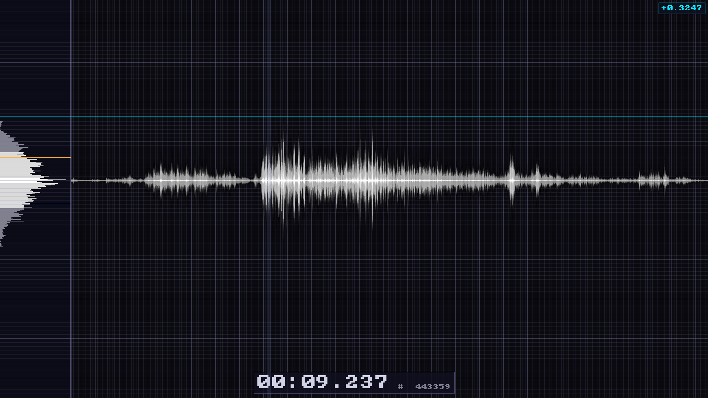

# wavpane

An SDL3-based interactive WAV waveform viewer with adjustable dynamic range and high-fidelity rendering.



## Build

Requires CMake 3.24+ and a C++23 compiler (GCC 13+ or Clang 16+).

```sh
cmake -B build -DCMAKE_BUILD_TYPE=Release
cmake --build build -j
```

- **SDL3** (3.2 or newer) is taken from the system when installed: `libsdl3-dev` on Debian/Ubuntu, `sdl3-devel` on Fedora, `sdl3` on Arch. Otherwise it's downloaded and built as a static library, which makes the first build take a while. To always use the bundled copy, add `-DFETCHCONTENT_TRY_FIND_PACKAGE_MODE=NEVER`.
- **Tests** are built by default. To skip them (and the GoogleTest download), add `-DBUILD_TESTING=OFF`.

## Install (Linux)

```sh
cmake --install build --prefix ~/.local     # or: sudo cmake --install build
```

This installs the `wavpane` binary, a desktop entry and an icon. wavpane then appears in the file manager's "Open With" menu for WAV files. It isn't listed in the application menu, since it always needs a file to open. If "Open With" doesn't list it right away, run `update-desktop-database ~/.local/share/applications`.

## Usage

```sh
wavpane file.wav
wavpane --help
```

- **A file argument is required.** Without one, wavpane prints its usage and controls and exits with status 1. `-h` / `--help` prints the same to stdout and exits with status 0.
- **Drag a WAV file onto the window** to switch to it. If several files are dropped at once, only the first is opened.
- **If a file can't be opened**, the error is shown in the window and the current file stays open. If the file from the command line fails, the window stays empty until a file is dropped on it.
- The open file's name is shown in the window title.

**Supported files:** 8/16/24/32-bit PCM and 32/64-bit float WAV, including `WAVE_FORMAT_EXTENSIBLE`. Multi-channel files are downmixed to a single mono trace. Truncated files, and streamed files with a placeholder data size (e.g. from ffmpeg writing to a pipe), are read up to the last complete frame.

**High-DPI displays** (e.g. 150% or 200% scaling): wavpane renders at the display's full resolution and scales its text and panels to match.

### Controls

Press `F1` to see these in the app.

| Input | Effect |
|---|---|
| Scroll | Zoom around the cursor (time + amplitude) |
| Shift+Scroll | Zoom time only |
| Left-drag | Pan |
| `Home` | Reset view |
| `Tab` | Background: dark / white |
| `G` | Toggle the background grid |
| `H` | Toggle the hover histogram |
| `L` | Hover histogram counts: linear / log |
| `+` (or `=`) / `-` | Antialiasing quality: 2x / 4x / 8x / 16x (default 4x; levels the GPU can't render at the current window size are skipped) |
| `1`–`9` | Where the white core ends: 1 = darkest (mean square), 8 = near white (peak), 9 = flat white (default 5) |
| `F` | Toggle fullscreen (covers the whole monitor, including panels) |
| `F1` | Help |
| `Esc` | Close help, leave fullscreen, or quit |
| Drop a file | Open it |

### On-screen readouts

- **Cursor time:** a vertical line follows the mouse. The time under it (`MM:SS.mmm`) and the matching sample index (`#12345`) are shown at the bottom of the window.
- **Amplitude:** a cyan horizontal line follows the mouse, and the amplitude under it is shown in the top-right corner.
- **Hover histogram:** a histogram of the samples under the cursor, docked to the left edge.
  - It shares the main view's amplitude axis: each 2px row is one bin, and bars grow rightward with the count.
  - Bars use the waveform's own rim / core / spine colors. Amber lines mark ±RMS.
  - The measured span is shaded on the waveform. It's the cursor column ±4.5 px (at 100% scaling), widened to at least 64 samples when zoomed far in.
  - It updates live, including while dragging or zooming. Switch to log counts (`L`) to see sparse tails.
  - At most 131,072 samples are scanned; larger spans are sampled at a stride.

## Rendering

- **Zoomed out** (more than 16 samples per screen pixel): one envelope bar per column, in three layers sized by that column's own statistics:
  - a dim gray **rim** spanning the true min..max,
  - a white **core** out to a statistic picked with `1`–`9` (mean square, RMS, cube or fourth-power mean, or peak),
  - an additive "hot" **spine** at the mean square.

  Colors fade toward black with the column's loudness relative to the file's peak. Each column's sample window overlaps its neighbors' to avoid moiré on periodic content.
- **Zoomed in** (16 or fewer samples per screen pixel): consecutive samples are joined with antialiased 2px segments.
- **Antialiasing:** the waveform is drawn into an offscreen texture at 2x–16x the window's resolution, then downsampled by repeated halving. A cheap 2x pass is used while panning or zooming; once the view settles, the configured factor is rendered once and cached until the view changes. The factor is capped by the GPU's maximum texture size: with the common 16384 px limit, a 1920 px wide window tops out at 8x.

Column statistics come from a min/max + power-sum pyramid (`waveform_pyramid.hpp`), which summarizes any sample range in O(log n).

## Testing

```sh
cmake --build build
ctest --test-dir build
```

The GoogleTest suite (fetched automatically) covers the WAV parser and file loading, the hover stats, time formatting, and the renderer (headless, via SDL's software renderer). Input handling and on-screen layout in `wav_main.cpp` are best checked by running the app.

## Files

| File | Contents |
|---|---|
| `wav_main.cpp` | The app: window, input, view state, on-screen readouts, hover histogram |
| `audio_loader.hpp` | Opens a file: read, mono downmix, peak, pyramid |
| `wav_reader.hpp` | WAV parser |
| `waveform_render.hpp` | `drawWaveform` and its color pipeline |
| `waveform_pyramid.hpp` | Range-query pyramid of min/max and power sums |
| `hover_stats.hpp` | Window stats (peak, RMS, power means) and histogram for the hover readout |
| `time_format.hpp` | `MM:SS.mmm` formatting for the cursor time readout |
| `packaging/` | Linux desktop entry and icon (installed by `cmake --install`) |
| `tests/` | Unit tests for the headers above |

## License

MIT; see [`LICENSE`](LICENSE).
